<div align="center">

<picture>
  <source media="(prefers-color-scheme: dark)" srcset="docs/banner-dark.svg">
  <source media="(prefers-color-scheme: light)" srcset="docs/banner-light.svg">
  
</picture>

[](https://github.com/maximilianfeix/hexvero/actions/workflows/ci.yml)
[](https://www.npmjs.com/package/hexvero)
[](package.json)
[](README.md#for-ai-agents)
[](LICENSE)

[English](README.md) · [Deutsch](README.de.md) · [Español](README.es.md) · [Français](README.fr.md) · [Português (Brasil)](README.pt-BR.md) · [Русский](README.ru.md) · [中文](README.zh.md) · **日本語** · [한국어](README.ko.md)

</div>

---

**Electron リリースの中で何が変わったかを知る。**

> この翻訳は[英語の README](README.md) より古い版です。現在の hexvero は主に Electron アプリの 2 つのビルドを比較します: IPC チャネル、preload ブリッジ、ウィンドウ設定、ネットワークホストを、両側のファイルと行番号付きで示します。

hexvero は実行ファイル、アプリバンドル、データベース、通信キャプチャをあなたのマシン上で**実行せずに**読み取り、何が見つかったか、どの程度確かか、何が判定できなかったかを示します。CLI、コーディングエージェント向けのコンパクトな MCP サーバー、ローカル Web UI を一つにまとめています。パーサーに必要なのは Node.js だけです。

## インストール

Node.js ≥ 22.12 が必要です。`npx hexvero` はインストールなしで動作し、`npm i -g hexvero` で `hexvero` コマンドが入ります。

## 読み取れる形式

ELF、PE、Mach-O（fat 含む）、Go buildinfo、.NET アセンブリ（メタデータと CIL メソッド本体）、WebAssembly、EVM バイトコード、SQLite、plist、HAR、ZIP/ZIP64、APK（AXML、resources.arsc、DEX）、JAR/Java クラス、Electron ASAR、JavaScript バンドル（webpack、Rspack、browserify、esbuild）と source map、Objective-C/Swift メタデータ付き Apple .app バンドル、Flutter スナップショット。すべての結果に確信度（`confirmed` または `inferred`）と明示的な制限が付きます。

## CLI

```bash
npx hexvero analyze ./program                 # 概要・所見・制限
npx hexvero collection ./program imports      # 一覧をページ送り
npx hexvero strings ./program --tag url       # タグ付き文字列
npx hexvero recover ./bundle.js ./out         # バンドルをモジュールに分割
npx hexvero calls ./program radare2 main      # 上限付きコールグラフ（radare2/rizin/Ghidra が必要）
npx hexvero ui --open                         # ローカル Web UI
npx hexvero setup --apply                     # MCP サーバーを登録
```

## AI エージェント向け

`hexvero mcp` は stdio 上で 15 個のツールを提供し、カタログは 32 KiB 未満です。開く、解析、コレクションと文字列のページ送り、バイト読み取り、エクスポート、比較、ソース復元、外部エンジンの操作が含まれます。`hexvero setup --apply` は Claude Code、Claude Desktop、Codex、Cursor、Windsurf、Gemini CLI、VS Code、OpenCode、Copilot CLI など検出されたクライアントにサーバーを登録します。

## 任意のエンジン

radare2、rizin、Ghidra は `PATH` から検出されます。hexvero がインストールすることはありません。いずれかがあれば、逆アセンブル、デコンパイル、相互参照、呼び出し元/呼び出し先、コールグラフ、検索が上限付き・キャッシュ付きで使えます。

完全なドキュメントは英語です: [README.md](README.md), [docs/cli.md](docs/cli.md), [docs/mcp.md](docs/mcp.md)。

## ライセンス

MIT。
