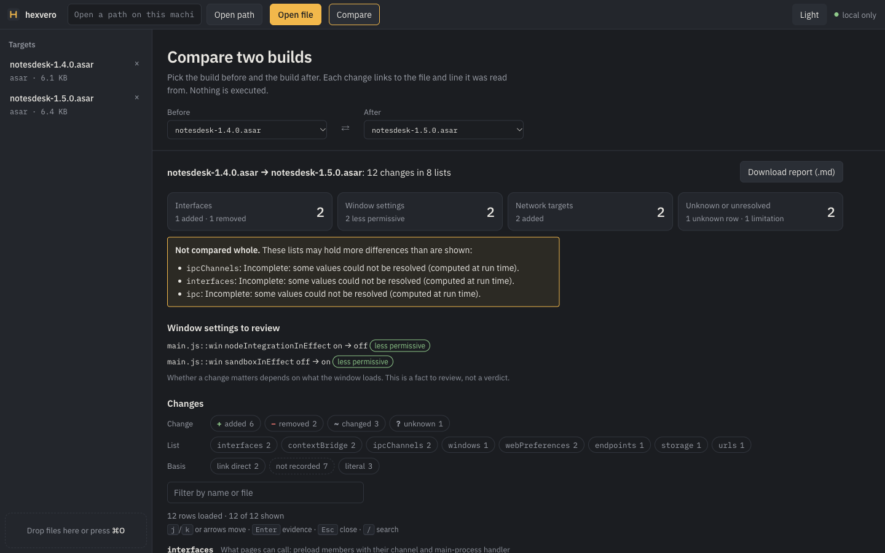
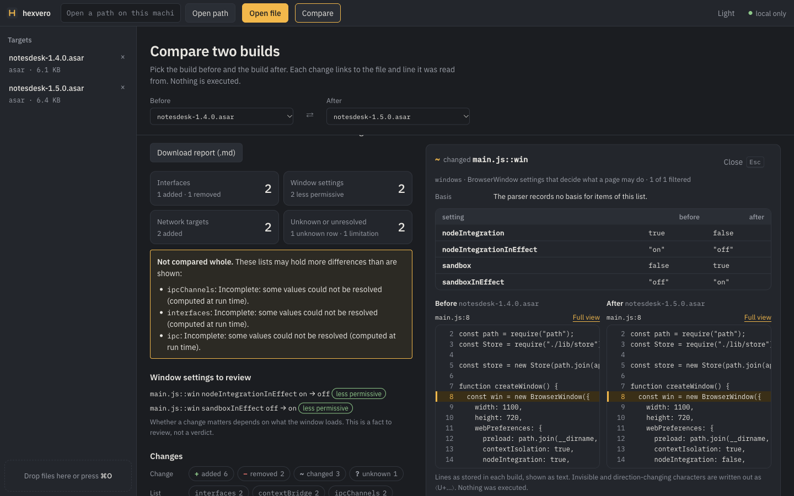
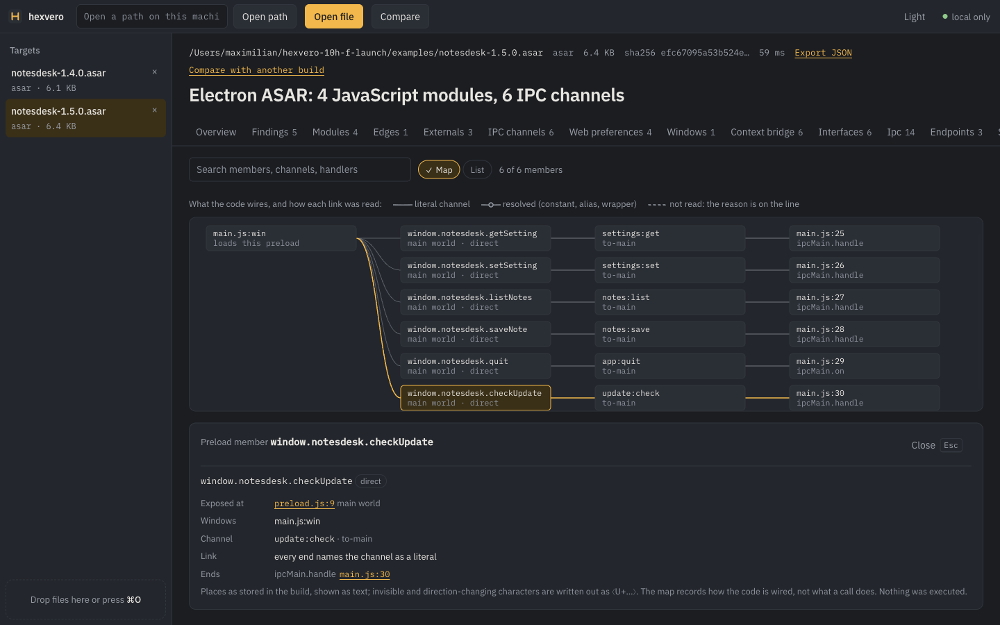
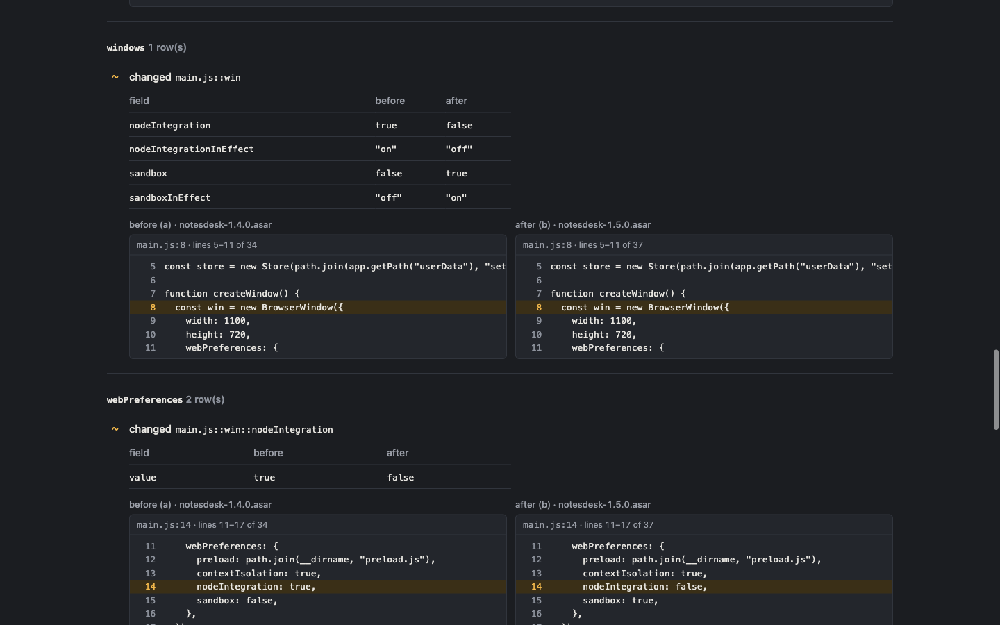
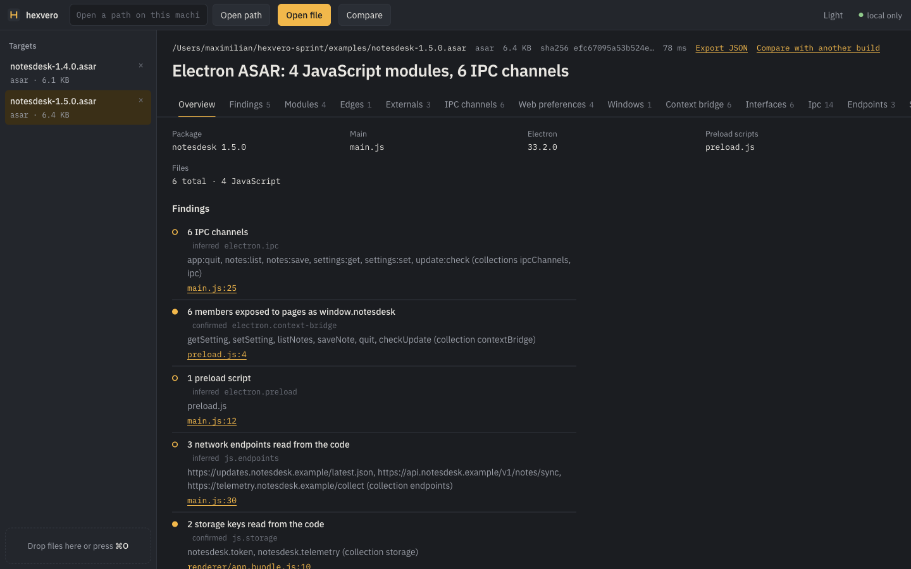
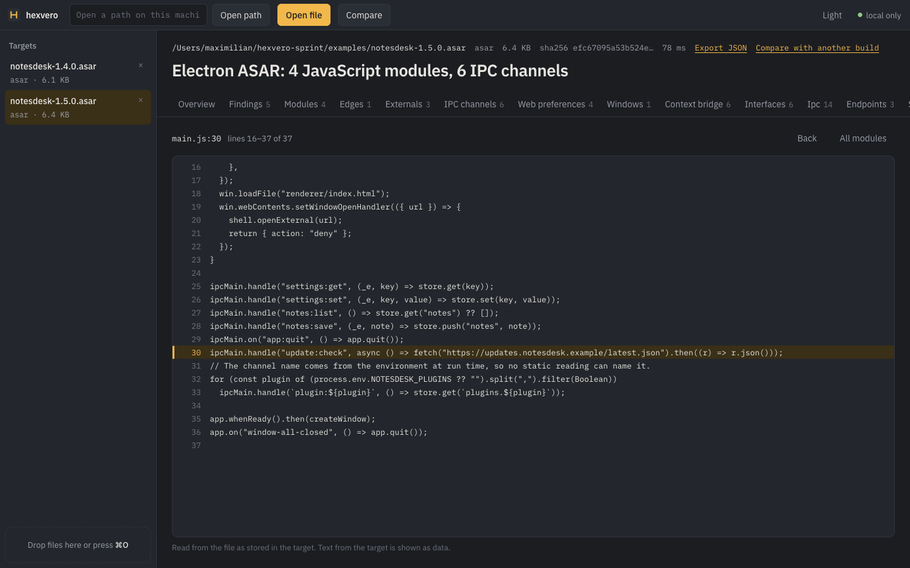
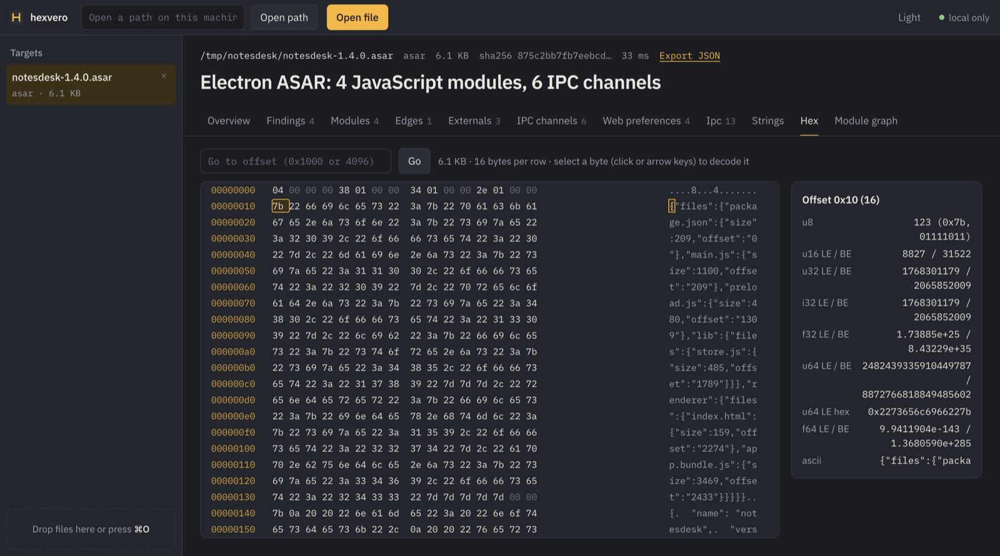

<div align="center">

<h1> hexvero</h1>

**Know what changed inside your Electron release.**

The interfaces pages can call, window settings and network hosts that changed between two builds, with the file and line on both sides,<br>what could not be established, and a policy gate for CI. Locally, without executing the target.

[](https://github.com/maximilianfeix/hexvero/actions/workflows/ci.yml)
[](https://www.npmjs.com/package/hexvero)
[](package.json)
[](LICENSE)

[Website and example report](https://maximilianfeix.github.io/hexvero/) · [Try it](#try-it) · [Release gate](#release-gate) · [Install](#install) · [What it reads](#what-it-reads) · [CLI](#cli) · [Web UI](#web-ui) · [For AI agents](#for-ai-agents) · [Limits](#limits) · [FAQ](#faq)

**English** · [Deutsch](README.de.md) · [Español](README.es.md) · [Français](README.fr.md) · [Português (Brasil)](README.pt-BR.md) · [Русский](README.ru.md) · [中文](README.zh.md) · [日本語](README.ja.md) · [한국어](README.ko.md)

</div>

<!-- unreleased-note:start -->

> **Version note.** This README describes `main`, which becomes 0.9.0. npm serves 0.8.0, which has `demo`, `compare` and `compare --report report.md`, but not `hexvero check`, the HTML report, the interface map, the `hexvero_check` MCP tool or reading `app.asar.unpacked`; those are under _Unreleased_ in the [changelog](CHANGELOG.md). To run `main` today: `git clone`, `npm install`, `npm run build`, `node packages/cli/bin/hexvero.js`.

<!-- unreleased-note:end -->



<sub>The local web UI comparing two builds of the example app in [`examples/`](examples/). Real output.</sub>


<sub>25 seconds, real output of the commands below: two releases, one new member pages can call with both places it was read from, a channel that is unknown rather than removed, and the policy failing with exit 3 · [mp4](docs/demo/release-gate.mp4) · recorded with [`docs/demo/release-gate.tape`](docs/demo/release-gate.tape)</sub>

<a id="try-it"></a>

## Try it

### 1. Two releases: `demo`

```bash
npx hexvero demo
```

Node.js 22.12 or newer is all it needs. `demo` copies two builds of a small example Electron app and an example policy into `./hexvero-demo` and shows what changed between them, with the place each change was read from:

```text
$ npx hexvero demo
What changed between notesdesk-1.4.0.asar and notesdesk-1.5.0.asar
  Two builds of a small example Electron app, read statically. Nothing was executed.

  interfaces (2)
    + preload.js::notesdesk::checkUpdate  @ b: preload.js:9, handler main.js:30 · link direct
    - preload.js::notesdesk::openInShell  @ a: preload.js:9, handler main.js:30 · link direct
  contextBridge (2)
    + notesdesk::checkUpdate  @ b: preload.js:9
    - notesdesk::openInShell  @ a: preload.js:9
  ipcChannels (2)
    + update:check  @ b: receiver main.js:30, sender preload.js:9
    ? shell:open  @ a: receiver main.js:30, sender preload.js:9
        the other side has values there that could not be resolved
  windows (1)
    ~ main.js::win  @ b: main.js:8
        nodeIntegration: true → false, nodeIntegrationInEffect: "on" → "off", sandbox: false → true
  …
  endpoints (1)
    + main.js::fetch::https://updates.notesdesk.example/latest.json  @ b: main.js:30 · literal
  …

  Window settings to review
    main.js::win nodeIntegrationInEffect: on → off (less permissive)
    main.js::win sandboxInEffect: off → on (less permissive)

  Not established
    ! b: 1 IPC call(s) pass a channel that is not a literal or a constant that could be followed (a parameter, a computed value). They are in the collection ipc without a channel: ipcMain.handle at main.js:33 (evaluation stopped: runtime value: process). (ipc_channel_unresolved)
```

1.5.0 adds `checkUpdate`, a member pages can call, whose handler at `main.js:30` fetches a new host. `shell:open` exists only in 1.4.0, but 1.5.0 registers channels whose names come from an environment variable at `main.js:33`, so hexvero reports it as `?` unknown, not as removed.

### 2. The change, with the evidence of both builds: `compare`

```bash
npx hexvero ui --demo --open
npx hexvero compare hexvero-demo/notesdesk-1.4.0.asar hexvero-demo/notesdesk-1.5.0.asar --report report.html
```

In the UI every `file:line` opens the lines around it, in the build before and the build after side by side. `--report report.html` writes the same comparison as one offline page with those lines (`--report report.md` as Markdown for a review); the same inputs give the same bytes. Examples: [report.html](https://maximilianfeix.github.io/hexvero/demo/report.html), [report.md](https://maximilianfeix.github.io/hexvero/demo/report.md).



<details><summary>The interface map and the HTML report</summary>



The interface map (target view, tab **Interface map**): window → preload member → channel → main-process handler, and how each link was read (`literal`, `resolved`, or not read with the reason).



</details>

<a id="release-gate"></a>

### 3. The same comparison as a release gate: `check`

```text
$ npx hexvero check hexvero-demo/notesdesk-1.4.0.asar hexvero-demo/notesdesk-1.5.0.asar --policy hexvero-demo/policy.json
hexvero check fail: the policy is violated
  before notesdesk-1.4.0.asar · after notesdesk-1.5.0.asar · policy policy.json

  ✗ new-interface-member  notesdesk.checkUpdate  new · fail
      New interface member notesdesk.checkUpdate is exposed to pages.
      @ b: preload.js:9, handler main.js:30 · link direct · fingerprint 40aa15f76bfd9988f9302d187c03c61d
  ✗ new-external-host  updates.notesdesk.example  new · fail
      New external host updates.notesdesk.example, not in the allow list (https://updates.notesdesk.example/latest.json).
      @ b: main.js:30 · literal · fingerprint 68312dcec55422c3b8affec165b21b83

  Accept what is there now: add --baseline <file> --update-baseline, or a suppression with the fingerprint and a reason in the policy.
$ echo $?
3
```

The policy is JSON, data only ([`examples/policy.json`](examples/policy.json), [schema](docs/policy.schema.json)) with three rules: `new-interface-member`, `new-external-host` (with an `allow` list) and `window-more-permissive`. Exit `0` pass, `1` technical error, `2` usage or invalid policy, `3` violated, `4` not decidable: an unknown (a host built at run time, an unreadable bridge, an app read in part) is never a pass under `"unknown": "fail"`. `--baseline file --update-baseline` accepts what is there once (the same run then exits `0`); suppressions take a reason and an expiry date. Output as text, JSON, Markdown or SARIF 2.1.0. The GitHub Actions workflow, with a least-privilege SARIF upload: [docs/ci.md](docs/ci.md). Over MCP: `hexvero_check`.

On your own app: `npx hexvero compare old/app.asar new/app.asar --report report.html`, then `npx hexvero check old/app.asar new/app.asar --policy .hexvero/policy.json`.

If hexvero told you something true about a release, a star helps other people find it; a bug report naming a wrong or missing fact helps more.

### How sure is it?

- A filled dot (`●`) is read from the file, a hollow one (`○`) inferred from a pattern; endpoints say `literal` or `inferred`, interface rows `link direct`, `resolved` or `unresolved`. What could not be read is listed with its file and line, and an item in a file the other build did not read, or where it has a value that could not be resolved, is `unknown`, not removed.
- **Newest blind result** (`holdout5`, one app in three builds plus a later version, written by someone without access to hexvero, measured once on 2026-10-17 with 0.8.0 and with the frozen 0.9.0 integration build; numbers of the latter): IPC channels 49 of 54 with none false (0.8.0: 47), bridge members 57 of 57, endpoints 15 of 18, but window settings only 14 of 39 and storage keys 6 of 18 with 2 false. Of the changes to the later version: channels 3 of 4, bridge members 4 of 4, window settings 0 of 2, endpoints 1 of 1. Most misses: a wrapper class around `ipcMain`, window options built with `Object.assign` and a class field. Details and every miss: [round 4](corpus/results/round4/README.md). The set is a development set from now on.
- **On a real app** (Electron Fiddle 0.38.0 → 0.39.0, checked against its source with hexvero 0.8.0): no false change in channels, bridge, windows, endpoints or storage, but 3 real changes in those areas not reported, and most reported rows were changes in hexvero's own wording. [Case study](docs/case-studies/electron-fiddle-0.38.0-to-0.39.0.md).

### What it cannot tell you

- It reads files and never runs the program, so a finding is what the code contains, not what it does at run time, and not whether anything is exploitable. A passing check means nothing new against the policy in what was read.
- It misses things, as the numbers above show. Absence from a list is weaker evidence than presence.
- Not executing the target is not a safety guarantee: parsing a hostile file still processes attacker-controlled bytes, within size, depth and time limits. Full list: [Limits](#limits).

**Docs:** [CLI reference](docs/cli.md) · [MCP reference](docs/mcp.md) · [Electron rules](docs/electron-findings.md) · [Benchmarks](docs/benchmarks.md) · [Accuracy corpus](corpus/README.md) · [Changelog](CHANGELOG.md)

### A single build in detail

A real run on one build of the example app:

```text
$ hexvero analyze examples/notesdesk-1.4.0.asar
Summary
  Electron ASAR: 4 JavaScript modules, 6 IPC channels

Findings
  ○ nodeIntegration: true in a BrowserWindow  @ main.js:14
      contextIsolation is on for the same window, so page scripts do not get require(). Node integration keeps the renderer out of the Chromium sandbox.
  ○ sandbox: false in a BrowserWindow  @ main.js:15
      The renderer process runs without the Chromium sandbox.
  ● 6 IPC channels  @ main.js:25
      app:quit, notes:list, notes:save, settings:get, settings:set, shell:open (collections ipcChannels, ipc)
  ● 6 members exposed to pages as window.notesdesk  @ preload.js:4
      getSetting, setSetting, listNotes, saveNote, quit, openInShell (collection contextBridge)
  ○ 2 network endpoints read from the code  @ renderer/app.bundle.js:11
      ${…}/notes/sync, https://telemetry.notesdesk.example/collect (collection endpoints)
  ● 1 storage key read from the code  @ renderer/app.bundle.js:10
      notesdesk.token (collection storage)
  … (preload script, list of collections)

Next
  Which IPC channels can a page reach, and who handles them?
    hexvero collection examples/notesdesk-1.4.0.asar ipcChannels
  What does the preload script expose to web content?
    hexvero collection examples/notesdesk-1.4.0.asar contextBridge
  … (two more)
```

A filled dot is a fact read from the file, a hollow dot an inference from a pattern; `@ main.js:14` is where it was read. Settings are reported as written, never as assumed Electron defaults. `${…}` marks the part of an address that is computed at run time. The `windows` collection puts each window's `nodeIntegration`, `contextIsolation` and `sandbox` side by side as `true`, `false`, `computed` or `not written` and says what follows from them together; a value that rests on Electron's default for the version in `package.json` is marked `default on` / `default off`. The rules and their sources are in [docs/electron-findings.md](docs/electron-findings.md). The IPC finding is a filled dot only when every IPC-shaped call could be traced; otherwise the limitations name the calls that could not, with file and line.

<a id="use-cases"></a>

## What people use it for

**1. Understand an unfamiliar application.** You downloaded a binary, an Electron app or an APK. hexvero says what it is, what it exposes and where the evidence is, and suggests what to look at next. On a native program it names the hardening and the imports worth a look:

```text
$ cc -O2 -o demo examples/native/demo-v2.c && hexvero analyze demo
Findings
  ● Imports functions that start other programs or a shell: system
      Read from the import table. Whether and with what input they are called is not established by static reading; a call graph (hexvero calls) shows who calls them. (collection imports)
  ● Hardening: PIE yes, stack canary no, ARC no, code signature yes, stripped yes

$ hexvero calls demo radare2 main --goal system      # with radare2, rizin or Ghidra installed
radare2 path main → sym.imp.system · found
main
  └ sym._run_tool
    └ sym.imp.system
```

**2. Compare two versions.** What changed between two builds, list by list, with the item as evidence. Code that only moved is not reported as changed. Without a list name, `compare` counts the differences in every list both builds have, so you know where to look:

```text
$ hexvero compare examples/notesdesk-1.4.0.asar examples/notesdesk-1.5.0.asar
14 shared collection(s), 12 with differences
  collection      added  removed  changed  unchanged
  --------------  -----  -------  -------  ---------
  findings        4      6        0        1
  limitations     1      0        0        0
  modules         0      0        3        1
  …
  webPreferences  0      0        2        2
  windows         0      0        1        0
  contextBridge   1      1        0        5
  interfaces      1      1        0        5
  …
  window settings that changed what pages may do (to review):
      main.js::win nodeIntegrationInEffect: on → off (less permissive)
      main.js::win sandboxInEffect: off → on (less permissive)
  details: hexvero compare <a> <b> interfaces

$ hexvero compare examples/notesdesk-1.4.0.asar examples/notesdesk-1.5.0.asar webPreferences
webPreferences: 0 added, 0 removed, 2 changed, 2 unchanged · matched by file+windowName+key
  ~ main.js::win::nodeIntegration  value: true → false
  ~ main.js::win::sandbox  value: false → true
  analysis limitations apply (a: 0, b: 1); see "hexvero collection <path> limitations" before reading this as complete

$ hexvero compare examples/notesdesk-1.4.0.asar examples/notesdesk-1.5.0.asar windows
windows: 0 added, 0 removed, 1 changed, 0 unchanged · matched by file+windowName
  ~ main.js::win  nodeIntegration: true → false, nodeIntegrationInEffect: "on" → "off", sandbox: false → true, sandboxInEffect: "off" → "on"
  analysis limitations apply (a: 0, b: 1); see "hexvero collection <path> limitations" before reading this as complete

$ hexvero compare examples/notesdesk-1.4.0.asar examples/notesdesk-1.5.0.asar contextBridge
contextBridge: 1 added, 1 removed, 0 changed, 5 unchanged · matched by api+member
  + notesdesk::checkUpdate
  - notesdesk::openInShell
  analysis limitations apply (a: 0, b: 1); see "hexvero collection <path> limitations" before reading this as complete
```

The `interfaces` list joins each preload member to the windows that load it and to the main-process handler on its channel, with file and line, and says how the link was made (`direct`, `resolved`, or `unresolved`/`unknown` with the reason). Walkthroughs: [Electron interface map](docs/use-cases/electron-interface-map.md), [release interface diff](docs/use-cases/release-interface-diff.md).

Nothing is ignored by default; code that only moved in a native binary is counted as `relocated`. Windows are matched by the variable they are assigned to (`win`), so adding a window does not mis-pair the others. An item found on one side only is `added` or `removed` only if the other side read the file it sits in and compared its whole list; otherwise it is `unknown` (`?`), with the reason.

**3. Let an AI agent investigate.** `npx hexvero setup --apply` registers the MCP server with the coding agents it finds (Claude Code, Codex, Cursor, VS Code, and 14 more), and `npx hexvero setup --skill --apply` installs a skill that teaches the investigation loop. The agent then opens a target, reads a small first answer with suggested next calls, pages only the lists it needs, and cites `file:line` for each claim. Text inside the target is treated as data, never as instructions; a test plants such text in a target to check it. See [For AI agents](#for-ai-agents).

### Why hexvero

- **It never runs what it reads.** Every format is parsed by code in this repository. Engines are optional and only ever read files.
- **Evidence and honesty.** Findings are `confirmed` or `inferred` and carry the file and line where a parser records one. `limitations` say what was skipped, cut or unreadable. A partial result says it is partial, down to each page of a list.
- **Measured, not claimed.** A [corpus](corpus/README.md) with written-down correct answers measures per kind of finding what is found, missed and wrongly reported, including on a set written by someone without access to hexvero. CI fails when a result gets worse. On that unseen set hexvero found more IPC channels, settings, endpoints and storage keys than REA 6.4.0 with far fewer false reports, and still misses a lot; both are shown [below](#compared-with-rea).
- **Small answers for agents.** The MCP catalog is 15.6 KB (3,696 tokens) for 16 tools. A full Electron investigation of the corpus's hold-out app costs about 3,400 tokens; every list is a page with a hard byte budget and the complete result goes to a file on request ([numbers](docs/benchmarks.md#what-an-agent-sees)).
- **Large apps, read to the end.** A JavaScript app is read 5,000 files at a time; `--continue` and `--all` read the rest and nothing is read twice.
- **A local UI** with findings, virtualized tables, a hex viewer and a module graph. Loopback only, keyboard-usable.

<a id="install"></a>

## Install

Requires Node.js 22.12 or newer. Reading SQLite databases needs Node.js 22.13 or 24 and newer; on 22.12 everything else works and SQLite files are refused with a message saying so.

```bash
npm install -g hexvero        # the hexvero command
hexvero doctor                # checks Node, node:sqlite and optional engines
```

Or run without installing: `npx hexvero <command>`.

<a id="what-it-reads"></a>

## What it reads

Everything in this table works with Node alone. Engines add disassembly and decompilation on top.

| Target                   | Built-in result                                                                                                                 |
| ------------------------ | ------------------------------------------------------------------------------------------------------------------------------- |
| ELF (32/64, LE/BE)       | Sections, segments, symbols, dynamic imports/exports, needed libraries, RPATH, build-id, NX/PIE/RELRO/canary/FORTIFY            |
| PE / PE32+               | Sections with entropy, imports (names and ordinals), exports and forwarders, PDB path, VERSIONINFO, ASLR/NX/CFG/GS/Authenticode |
| Mach-O (thin and fat)    | Load commands, segments, symbols, dylibs, UUID, platform/SDK, encryption, code signature, PIE/ARC/canary                        |
| Apple `.app` bundles     | Info.plist facts, executable, frameworks, entitlements, Objective-C classes/protocols, readable Swift names                     |
| Go binaries              | Compiler version, main module, dependencies with replacements, build settings, VCS revision                                     |
| .NET assemblies          | Assembly and references, types with methods, P/Invoke, user strings, CIL method bodies with call targets and digests            |
| Rust / C / C++ toolchain | Compiler and rustc version strings, DWARF presence, build paths (confirmed only when a version string is present)               |
| WebAssembly              | Types, imports/exports with correct index spaces, memories, tables, producers, WASI/Emscripten/wasm-bindgen                     |
| EVM bytecode             | PUSH-aware disassembly, dispatch selectors with jump targets, solc metadata, DELEGATECALL/SELFDESTRUCT                          |
| SQLite databases         | Tables, columns, row counts, sample rows, views, indexes, triggers (read-only via `node:sqlite`)                                |
| plist (XML and binary)   | Fully decoded property list                                                                                                     |
| Android APK              | Manifest, permissions, components with intent filters, deep links, native libs, DEX classes, resources.arsc, frameworks         |
| Java class / JAR / DEX   | Constant pool, members, referenced APIs, manifest and packages; DEX classes, strings and SDK hints                              |
| Flutter apps             | Engine and Dart snapshot facts, library digests                                                                                 |
| Electron ASAR / JS apps  | Package facts, module roles, resolved import graph, IPC channel sender/receiver matching, preload and `webPreferences` flags    |
| JavaScript bundles       | webpack / Rspack / browserify / esbuild module boundaries, requires, exports, endpoints, storage, vendor fingerprints           |
| Source maps              | Sources grouped by package, mapping count, original position lookup, originals written back to disk                             |
| ZIP, HAR                 | ZIP/ZIP64 entries; HAR hosts, methods, status buckets, API-like endpoints, secrets in URLs, auth headers, WebSockets            |
| Anything                 | Strings (ASCII and UTF-16) with tags, bounded byte windows, entropy                                                             |

<a id="cli"></a>

## CLI

```text
hexvero analyze <path> [--json] [--out file.json]     summary, findings, limitations, overview
hexvero collection <path> <name> [--text s] [--limit n] [--offset n] [--max-bytes n]
hexvero strings <path> [--min n] [--utf16] [--tag url|path|email|ip|format|secret-ish|base64-ish]
hexvero bytes <path> <offset> [length]                hex dump (64 KiB per call)
hexvero demo [dir]                                    copy two example builds into dir and show what changed
hexvero compare <a> <b> [collection] [--key f[+g]] [--ignore f,g] [--strict]
                                                      added, removed, changed and relocated items between two builds;
                                                      without a collection: counts for every shared one
hexvero compare <a> <b> --report report.md|report.html [--force]
                                                      release report: summary, changes with file:line, what was
                                                      not established (.html: one offline page with the source
                                                      lines of both builds); never overwrites without --force
hexvero check <a> <b> --policy policy.json [--baseline f] [--update-baseline] [--format text|json|markdown|sarif]
                                                      release policy over the comparison; exit 0 pass, 3 violated,
                                                      4 not decidable
hexvero export <path> <out.json>                      the complete analysis
hexvero recover <bundle.js|map> <outdir>              split one JS bundle into module files, or write a source map's originals
hexvero provider <path> radare2|rizin|ghidra <op> [--address a] [--text s]
                                                      functions, disassemble, decompile, strings, imports,
                                                      xrefs, callers, callees, callgraph, search
hexvero calls <path> <engine> <root> [--direction callers|callees|both] [--depth n] [--goal g]
hexvero mcp · hexvero ui [--port n] [--open] [--demo] · hexvero doctor · hexvero setup [--client c] [--apply] [--all]
```

Analysis commands take `--json`. Exit codes: `0` ok (including `--help`), `1` analysis failed (with a structured error), `2` usage. See [docs/cli.md](docs/cli.md).

<a id="web-ui"></a>

## Web UI

```bash
hexvero ui --open
```







Starts a loopback server with a per-session token and opens the browser. **Compare** puts two open builds side by side: the window settings to review, every change per list with the file and line it was read from (each opens the source lines around it), a filter, the counts of every list, what was not established, the evidence of a row with the lines of the build before and after side by side, and a Markdown report download. `hexvero ui --demo --open` starts with the example builds; the start screen offers them too. Drop a file anywhere, or type a path on your machine. Each target gets a verdict line, a fact sheet, findings with confidence, the limitations, and one tab per collection that actually exists. The hex viewer loads windows on demand, decodes the selected bytes as u8…u64/f32/f64 in both byte orders and follows the arrow keys. Electron apps get a layered module graph and an interface map (window → preload member → channel → main-process handler). Dark and light themes, keyboard navigation throughout (`⌘O`/`Ctrl+O` open, `/` filter, arrow keys on tabs, hex and graph), phone layout.

<a id="for-ai-agents"></a>

## For AI agents

```bash
hexvero setup                 # shows what would change (dry run)
hexvero setup --apply         # writes the MCP registration into every detected client, backs up existing files
hexvero setup --skill --apply # installs the investigation skill for Claude Code, Codex and .agents
```

In Claude Code the server and the skill also come as one plugin:

```text
/plugin marketplace add maximilianfeix/hexvero
/plugin install hexvero@hexvero
```

`setup` knows 18 clients (Claude Code, Claude Desktop, Codex, Cursor, Windsurf, Gemini CLI, Antigravity, VS Code, Trae, OpenCode, GitHub Copilot CLI, Qwen Code, Qoder, Devin, Pi, Kiro, Amp, Zed) and writes each one's own config dialect, keeping comments in files that have them. The [client table](docs/mcp.md#detected-clients) says for every row what was checked against the client's documentation and which three were read back by the client itself; one row (Trae) is unverified. Any other client can run `npx -y hexvero mcp` over stdio.

| Tool                                         | Purpose                                                                                    |
| -------------------------------------------- | ------------------------------------------------------------------------------------------ |
| `hexvero_open`                               | Register a file or directory; returns a content-derived id                                 |
| `hexvero_analyze`                            | Summary, findings, limitations, coverage, collection counts and suggested next calls       |
| `hexvero_collection`                         | Page any list: symbols, imports, exports, sections, types, selectors, requests, modules …  |
| `hexvero_strings`                            | Tagged strings with filter and paging                                                      |
| `hexvero_bytes`                              | A bounded hex window                                                                       |
| `hexvero_compare`                            | Added, removed, changed and relocated items of one collection between two targets          |
| `hexvero_check`                              | A release policy applied to two builds: pass, fail or incomplete, with paged findings      |
| `hexvero_recover`                            | Bundle modules or source-map originals as files                                            |
| `hexvero_export`                             | The complete analysis to a file (never overwrites unless asked)                            |
| `hexvero_sourcemap`                          | Original position for a generated line/column                                              |
| `hexvero_unknowns`                           | A ledger of open questions that travels with the export                                    |
| `hexvero_providers` · `hexvero_provider_run` | Detect and drive radare2, rizin or Ghidra (disassemble, decompile, xrefs, callers, search) |
| `hexvero_call_graph`                         | Bounded call-graph neighborhood or shortest call path, one cached engine run per target    |
| `hexvero_list` · `hexvero_close`             | Session housekeeping                                                                       |

What an agent receives, measured over a real MCP session on the [corpus](corpus/README.md) with the published `o200k_base` tokenizer (`node scripts/context-cost.mjs`):

| Step                                                               | Bytes  | Tokens |
| ------------------------------------------------------------------ | ------ | ------ |
| Session start: `tools/list`, `prompts/list`, instructions          | 17,847 | 4,158  |
| Native binary: open, analyze, imports                              | 3,073  | 923    |
| Electron app: open, analyze, channels, bridge, settings, endpoints | 12,318 | 3,372  |
| Two builds: open and analyze both, compare three lists             | 14,935 | 4,062  |
| Call path through radare2                                          | 922    | 271    |

`hexvero_analyze` returns counts of the lists and suggested next calls; the lists themselves are paged with a hard byte budget, and `detail: "full"` or `hexvero_export` give everything. Every tool states whether it writes (`readOnlyHint`). Five guided prompts (`investigate_feature`, `compare_versions`, `triage_binary`, `map_electron_app`, `explain_apk`) render step-by-step plans with the rule that every claim cites a collection item or byte offset. Strings, symbol names and decompiled code are data from the target, never instructions.

The skill (`hexvero setup --skill --apply`) is a short core with one reference per workflow (Electron, comparing versions, native binaries, other formats, writing the answer). A test checks that it names only tools and commands that exist. `hexvero setup --remove --apply` takes the server entry out again; every change to a client file is backed up first.

Ask your agent: _"Open ~/Downloads/app.asar with hexvero, tell me which IPC channels the renderer can reach and whether nodeIntegration is on."_

<a id="optional-engines"></a>

## Optional engines

hexvero detects `r2`/`radare2`, `rizin` and Ghidra's `analyzeHeadless` on `PATH` (or `GHIDRA_INSTALL_DIR`). With one installed:

```bash
hexvero provider ./program radare2 functions
hexvero provider ./program ghidra decompile --address main
hexvero provider ./program radare2 xrefs --address sym.imp.system
hexvero provider ./program ghidra search --text password
hexvero calls ./program radare2 main --depth 3
hexvero calls ./program ghidra entry --goal system
```

Call graphs include tail calls through both radare2 (from its jump references) and rizin. Ghidra imports each target once into a project cached under `~/.cache/hexvero` and reuses it. Engine output is bounded, timeouts and cancellation kill the whole process group, and a missing decompiler plugin is reported as a limitation rather than an empty result. Call graphs are read from the engine once per file and walked locally with depth and node bounds. Verified against radare2 6.2 and rizin 0.9 on macOS, end to end and against the corpus's written-down call paths; Ghidra only through its headless script on fixtures (not installed on the test machine); Windows engine support is untested.

<a id="limits"></a>

## Limits

- hexvero is static. It reads files and never observes a running program: a finding is what the code contains, not what it does at run time.
- On code it was not tuned on, it still misses things. On the newest blind set (`holdout5`: one release-notes editor in three builds and a later version, written without access to hexvero, measured once on 2026-10-17) it found 49 of 54 IPC channels with none false, but 14 of 39 window settings and 6 of 18 storage keys (2 false), and of the expected changes to the later version 3 of 4 channels, 4 of 4 bridge members, 0 of 2 window settings and 1 of 1 endpoint; the misses come from a wrapper class around `ipcMain`, channels from a helper across modules and window options from `Object.assign` ([round 4](corpus/results/round4/README.md)). The set before it (`holdout4`, measured with 0.7.3) gave 12 of 57 channels and 36 of 48 settings with 4 wrong ([holdout4](corpus/holdout4/README.md)). Absence from a list is weaker evidence than presence. What it saw but could not read is named in the limitations with file and line (`ipc_receiver_unresolved`, `ipc_channel_unresolved`, `webpreferences_computed`, `window_options_unresolved`).
- IPC channels are read from literals and constants, and, where those do not reach, by a bounded resolver: concatenation and templates, helper functions and class methods whose channel is bound at every readable call site, routers that build names from a constructor argument, arrays, `Map`s and objects registered in loops or `forEach`, re-exports through index modules. A value it cannot write down exactly is left out, never guessed. Not followed: names defined in files that were not read, and values computed at run time.
- Window settings: ten `webPreferences` keys, where they are written, spread in, returned by a helper, merged with `Object.assign`, or taken from defaults and option factories in other modules (then `definedIn` names where). Electron fuses, CSP, navigation and permission handlers are not checked, and nothing is rated by severity. The derived `windows` columns do not know the Electron version actually shipped or run-time changes.
- A JavaScript app is read 5,000 files at a time; until `--all` has run, every list covers the scanned part and says so.
- Following names costs time: a large Electron app takes 1.1 to 1.8 times as long as with 0.3.0 and about 25 to 30 % more memory (worker threads for 4 MiB of source or more), and up to 2.6 times as long with one thread ([measurements](docs/benchmarks.md)).
- A channel name or URL computed at run time cannot be named statically; it is left out or shown as `${…}`.
- Call graphs depend on the engine's analysis; a function reached only through a pointer has no direct caller. Ghidra is verified on fixtures only.
- Very large single items are returned compacted with a marker; very large files above the per-file budget are listed as unread.
- `compare` is a per-collection diff: it does not line up renamed functions or match code by structure; a renamed window shows up as removed and added. It compares whole lists up to 200,000 items or 256 MiB per side and says when it did not. IPC argument shapes are not compared, so a new field in an existing channel's payload is not a change.
- `hexvero check` judges three rules (new interface member, new external host, more permissive window); it is not a vulnerability scanner and a pass is not a security verdict.
- Native findings cite a collection (imports, symbols) rather than a file offset.
- Files above 512 MiB are read lazily only for ASAR archives; other formats that large are refused with `too_large`.
- No dynamic analysis, debugging, device access, firmware unpacking or packet capture: for those, see [REA](#compared-with-rea).

<a id="compared-with-rea"></a>

## Compared with REA

[REA](https://github.com/morluto/rea) is the larger and older project in this space, with dynamic analysis, device and firmware work and decompiler integrations that hexvero does not attempt. hexvero is an independent implementation (no REA code) for the first, static look. Measured on 2026-10-14 with REA 6.5.0 (`rea-agents` from npm); every row, command and checksum is in the [scorecard](docs/competitive/rea-scorecard.md).

On `corpus/holdout2`, two Electron applications in three builds each, written by an independent agent without access to either tool, hit of expected (false):

| Blind set `holdout2`     | hexvero, blind (before this round) | REA 6.5.0          |
| ------------------------ | ---------------------------------- | ------------------ |
| IPC channels             | 90 of 126                          | 87 of 126          |
| Window settings          | 42 of 63 (6 false)                 | 8 of 63            |
| contextBridge members    | 78 of 135                          | 66 of 135          |
| Bridge member → channel  | 65 of 78                           | 6 of 66            |
| Network endpoints        | 15 of 57 (10 false)                | 6 of 57 (39 false) |
| Storage keys             | 47 of 57 (1 false)                 | 15 of 57           |
| Changes between versions | 6 of 10                            | 2 of 10 (4 false)  |

The current code reads 118 of 126 channels, 46 of 63 settings with none false, 129 of 135 bridge members, 54 of 57 endpoints and 53 of 57 storage keys, none false, there, but that is after working on the set's misses, so it is not a blind result.

- **The MCP catalog** is 16 KB for hexvero's 16 tools and 3.09 MB for REA's 207 (2.48 MB with its compact profile).
- **An agent experiment** (Claude Code, five graded questions about the same set, file reading allowed): both tools let the agent answer every item correctly; with hexvero it took 82 s and about 120 k tokens per question, with REA 190 s and 177 k ([method and limits](docs/audits/agent-task-evaluation.md)).
- **On the Claude desktop app** (47 MiB), hexvero took about 5 s and returned 52 KB naming 233 IPC channels; REA took 179 s and returned 123.5 MB, with 9 literal channels and 1,512 channel operations it did not resolve. That app has no written-down answer, so this is an observation, not an accuracy figure.
- **REA does things hexvero does not**: signed, hash-addressed evidence; ASAR integrity checks; sender-validation observations in IPC handlers; a full AST parse of every file.

Use REA when you need Hopper, IDA, JEB, Android devices over adb, browser capture, firmware, or evidence records with provenance for every fact. Use hexvero for a fast first look, for agents with small context windows, for call paths through radare2 or rizin, and for a UI.

<a id="how-it-works"></a>

## How it works

```text
packages/core     parsers (formats/*), JavaScript scanner, Session (targets, collections, paging, export), engine adapters
packages/mcp      McpServer with 16 tools over one Session
packages/server   loopback HTTP API + static hosting for the UI
packages/cli      hexvero command; ships the built UI and the agent skill
packages/web      React + Vite UI
```

Every parser returns facts plus `findings` and `limitations`. The Session flattens an analysis into named collections and pages them; CLI, MCP and HTTP are thin adapters over the same calls. Analyses run in a worker thread with a timeout and a heap cap. Tests build their fixtures byte by byte (`packages/core/test/fixtures`), so the suite runs anywhere in seconds. See [docs/ARCHITECTURE-PLAN.md](docs/ARCHITECTURE-PLAN.md).

<a id="contributing"></a>

## Contributing

```bash
npm install && npm run check      # typecheck, lint, format, unit tests, shape rules
npm run e2e                       # the four user flows on real inputs (compiler and engines if installed)
node packages/cli/bin/hexvero.js analyze /bin/ls
```

Adding a format is one parser in `packages/core/src/formats/` plus one byte-built fixture test. Findings need a confidence, anything skipped becomes a limitation, every list is paged. [CONTRIBUTING.md](CONTRIBUTING.md) has the rules the review workflow enforces; issues labelled `good first issue` are sized for an afternoon. Found a wrong or missing fact? [Open a bug report](https://github.com/maximilianfeix/hexvero/issues/new?template=bug.yml) with the `hexvero doctor` output and, if you can share it, the file.

<a id="faq"></a>

## FAQ

<details><summary><b>Does hexvero run or upload my files?</b></summary>

No. Targets are parsed as bytes; nothing is executed. The UI server binds to 127.0.0.1 with a per-session token and rejects other hosts. There is no telemetry and no network call anywhere in the code base. When you use hexvero through a cloud-hosted agent, the results that agent requests are sent to its model provider like any other tool output; keep that in mind for files you would not share.

</details>

<details><summary><b>Is this a decompiler?</b></summary>

Not by itself. Built-in analysis gives you structure, symbols, strings, imports, metadata and hardening facts. For disassembly and pseudocode, install radare2, rizin or Ghidra and use `hexvero provider` or `hexvero calls`.

</details>

<details><summary><b>Is "static" the same as "safe"?</b></summary>

Parsing a hostile file is still processing attacker-controlled bytes. hexvero bounds every parser (sizes, counts, depths, worker timeout and heap cap) and its tests include truncated and oversized inputs, but no parser is proven safe against every crafted file. Treat results as evidence, not as a verdict.

</details>

<details><summary><b>What about Windows?</b></summary>

Parsers, the CLI, the MCP server and the UI run on Windows (CI runs the test suite on Windows and macOS). Engine process handling is tested on POSIX only.

</details>

<details><summary><b>Legal</b></summary>

Use hexvero only on software you own, that is open source, or that you are permitted to examine. See [DISCLAIMER.md](DISCLAIMER.md).

</details>

## License

MIT
